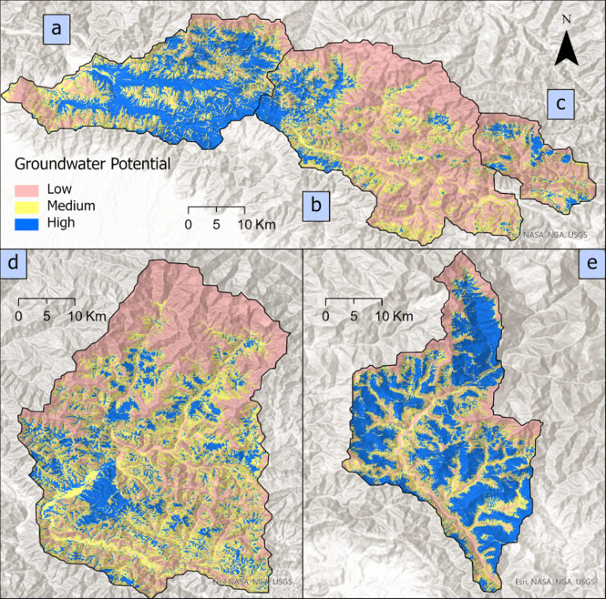
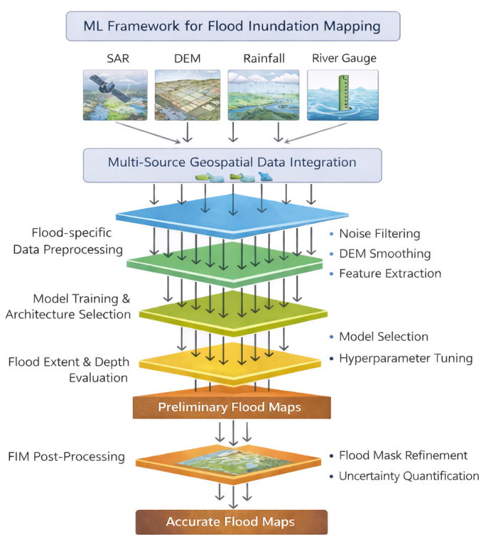
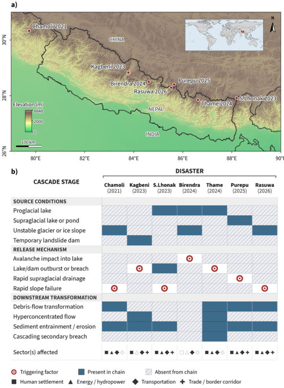
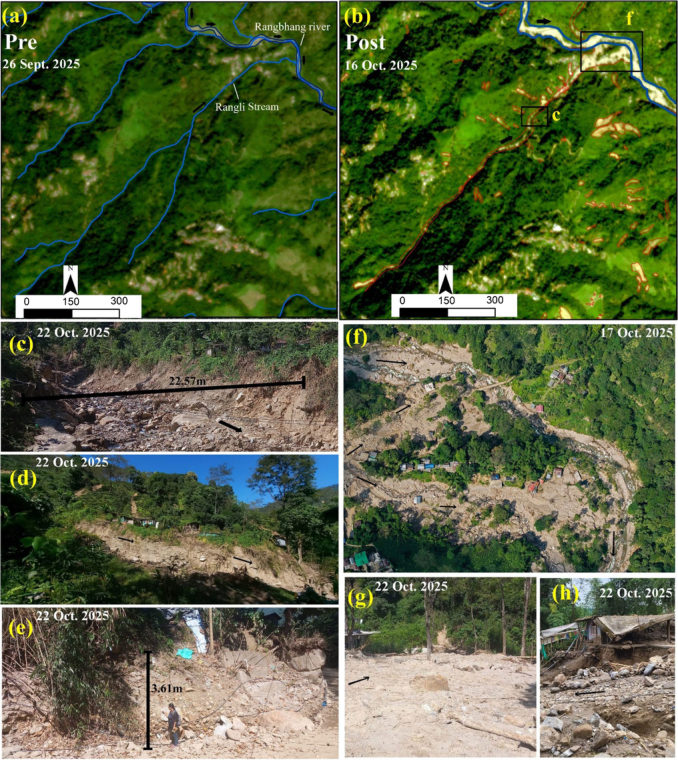
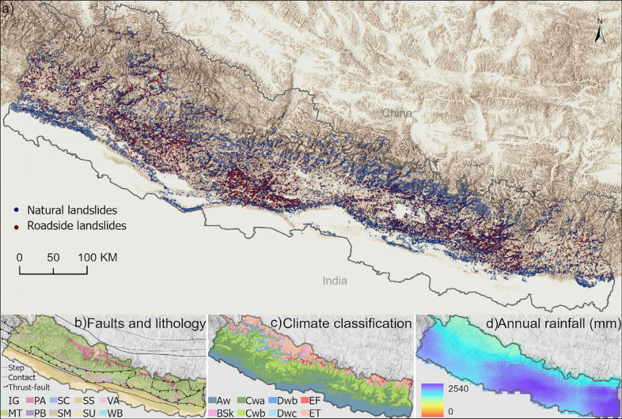
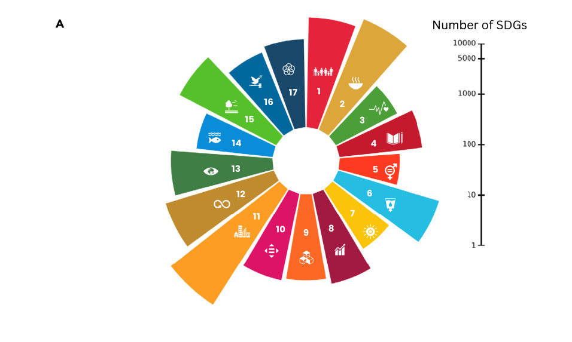
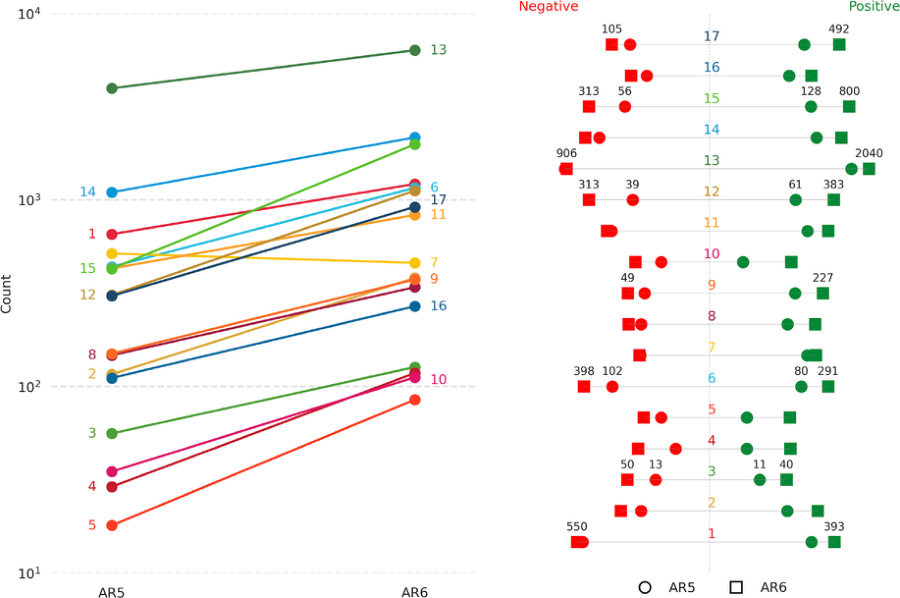

I build artificial intelligence and physics-based methods that make water and hazard predictions more accurate, better quantified, and easier to trust. My work runs in three threads, shown here through figures from my papers ([all publications](/publications/)).

### 1. Mountain and arid hydrology
AI and physics-based models that forecast streamflow with quantified uncertainty and map water where data are scarce.

<figure class="paper-fig"><figcaption>Ensemble forecast skill and uncertainty across US basins (<a href="https://www.sciencedirect.com/science/article/abs/pii/S1568494626007246">Dahal et al., 2026</a>)</figcaption></figure><figure class="paper-fig"><figcaption>Groundwater potential zones mapped with explainable machine learning (<a href="https://doi.org/10.1016/j.jhydrol.2023.130417">Dahal et al., 2023</a>)</figcaption></figure><figure class="paper-fig"><figcaption>A machine-learning framework for flood inundation mapping (<a href="https://doi.org/10.3390/earth7020044">Silwal et al., 2026</a>)</figcaption></figure>

### 2. Hazards and infrastructure risk
Mapping and forecasting cascading hazards, from landslides and outburst floods to the roads, bridges and schools they threaten. After the 2026 Langtang Disaster on the China–Nepal border, we reproduced the event in physics-based simulations ([preliminary reconstruction](https://livingmountains.github.io/blog/2026/08/28/langtang-reconstruction.html)).

<figure class="paper-fig"><figcaption>Seven cascading disasters across the Himalaya, 2021 to 2026 (<a href="https://doi.org/10.1038/s44304-026-00292-7">Silwal & Dahal, 2026</a>)</figcaption></figure><figure class="paper-fig"><figcaption>Landslides and flooding in Darjeeling, October 2025 (<a href="https://doi.org/10.1007/s10346-026-02743-8">Ghosh et al., 2026</a>)</figcaption></figure><figure class="paper-fig"><figcaption>Natural and roadside landslides across Nepal (<a href="https://doi.org/10.1016/j.scitotenv.2023.162242">Gnyawali et al., 2023</a>)</figcaption></figure>

### 3. Sustainable development
Earth observation and machine learning to inform water, food and land decisions.

<figure class="paper-fig"><figcaption>Forest fires across Nepal and their seasonal timing (<a href="https://doi.org/10.1016/j.infgeo.2025.100003">Dahal et al., 2025</a>)</figcaption></figure><figure class="paper-fig"><figcaption>How urban agriculture links to the 17 SDGs (<a href="https://doi.org/10.1016/j.crsus.2024.100217">Pradhan et al., 2024</a>)</figcaption></figure><figure class="paper-fig"><figcaption>How IPCC reports engage with each SDG (<a href="https://doi.org/10.1016/j.resenv.2025.100192">Pradhan et al., 2025</a>)</figcaption></figure>

---
## Currently
At the University of Kansas (May 2026 – present), I conduct AI, satellite earth observation, and geospatial research on water resources and water-distribution infrastructure under natural hazards, on an NSF-funded project. Recent fellowship: AGU Thriving Earth Exchange Community Science Fellow on the [Lumberton, NC flood project](https://thrivingearthexchange.org/project/lumberton-nc/) (2024 – 2026).

I am part of the [Living Mountains Group](https://livingmountains.github.io), an independent research collective observing, modeling and forecasting a changing mountain world.

Open to collaborations on:

* mountain and arid hydrology, and AI streamflow forecasting.
* multi-hazard and infrastructure-risk mapping.
* earth observation for water, food, and infrastructure resilience.

[Book a 30-minute call →](https://calendar.app.google/6FXuzivEFvFhLHx76)

## News

* November 20, 2026: Received the Thriving Earth Exchange travel award to attend AGU26 in San Francisco.
* November 3, 2026: Our perspective on cascading mountain hazards and early warning is out in *npj Natural Hazards* ([paper](https://doi.org/10.1038/s44304-026-00292-7)).
* September 30, 2026: Interviewed by *Science News* about the 2026 Langtang Disaster on the China–Nepal border ([article](https://www.sciencenews.org/article/flood-nepal-prepare-disaster-climate)).
* August 26, 2026: Spoke to *FOX Weather* about the 2026 Langtang Disaster on the China–Nepal border ([video](https://livingmountains.github.io/blog/2026/08/26/langtang-fox-weather.html)).

[More news →](/news/)

## Find your way

* [Publications](/publications/): full list with links and citations.
* [CV](/cv/): appointments, awards, and talks.
* [Resources](/resources/): open course materials and code (Stats, py4all, azwaters).
* [News](/news/): updates and selected media coverage.
* [Living Mountains Group](https://livingmountains.github.io): our research collective on mountain water and hazards.

Reach me at **geokshitij [at] gmail [dot] com** or via [Google Scholar](https://scholar.google.com/citations?hl=en&user=jOtnPBIAAAAJ&view_op=list_works).

