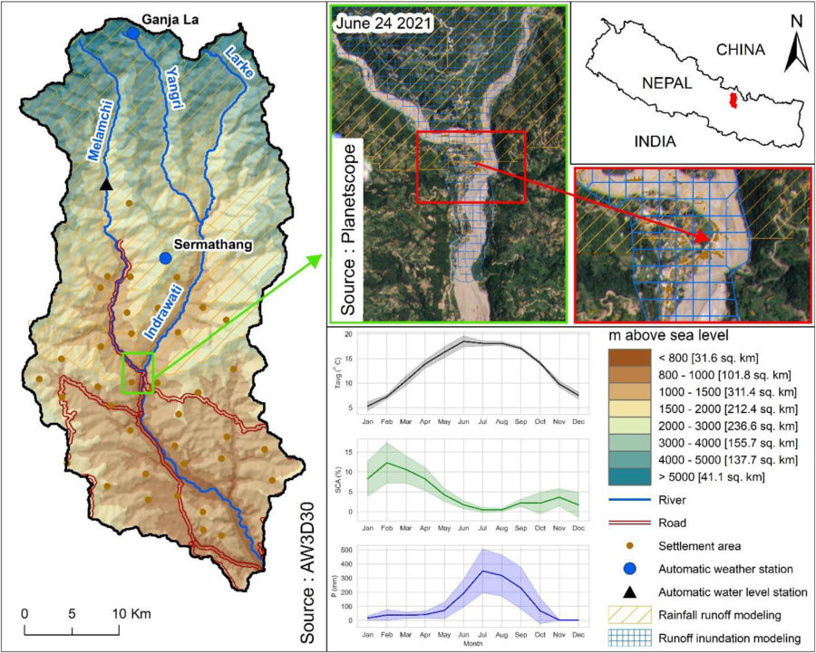
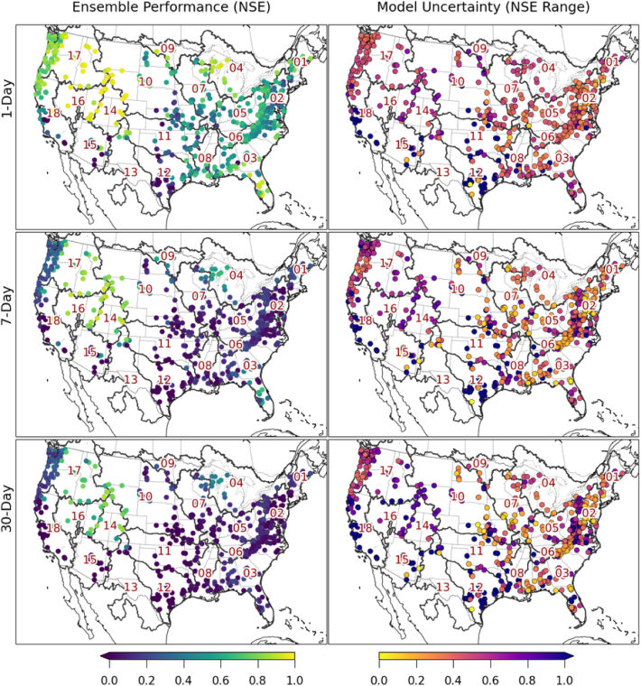
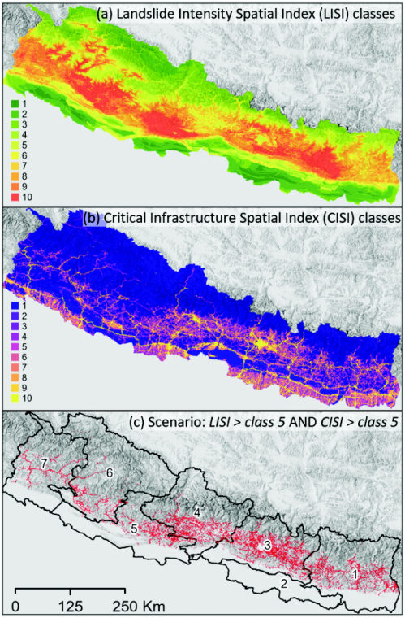
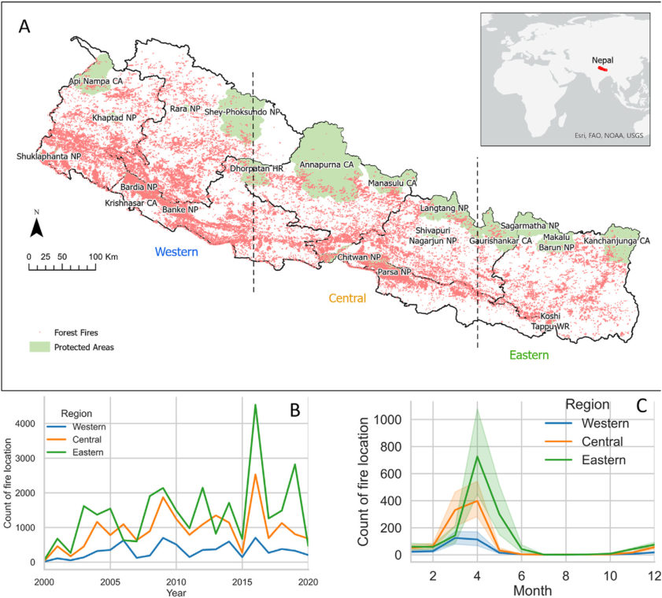
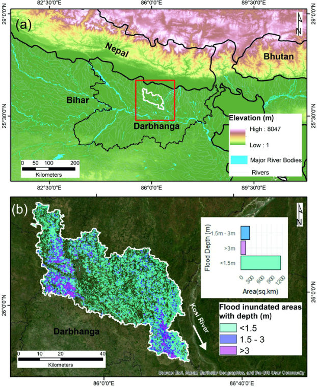
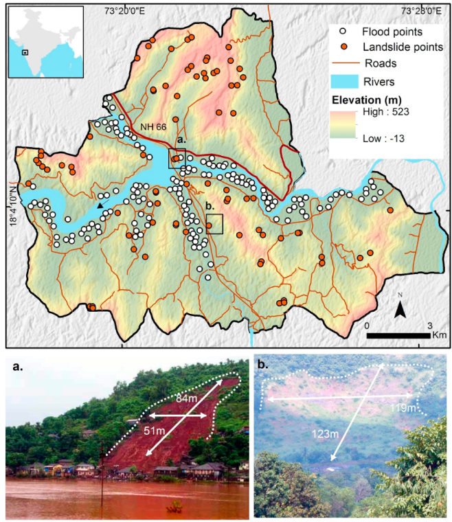

I study floods that begin with a sudden failure upstream, such as a slope failure, a glacier collapse, a lake outburst, a dam or levee breach, or runoff from a burned hillside. These floods carry rock, ice, soil and water far down the valley and exceed what our models and designs expect. My research combines physics-based models, satellite observation and AI in three directions, shown here through figures from my papers ([all publications](/publications/)).

### 1. How sediment-laden floods form and travel
Physics-based reconstructions of floods that carry rock, ice, mud and water, to learn what makes them destructive. After the 2026 Langtang Disaster on the China–Nepal border, we reproduced the event in physics-based simulations ([preliminary reconstruction](https://livingmountains.github.io/blog/2026/08/28/langtang-reconstruction.html)).

<figure class="paper-fig"><figcaption>Seven cascading disasters across the Himalaya, 2021 to 2026 (<a href="https://doi.org/10.1038/s44304-026-00292-7">Silwal & Dahal, 2026</a>)</figcaption></figure><figure class="paper-fig"><figcaption>Landslides and flooding in Darjeeling, October 2025 (<a href="https://doi.org/10.1007/s10346-026-02743-8">Ghosh et al., 2026</a>)</figcaption></figure><figure class="paper-fig"><figcaption>Cascading hazards on mountain terrain (<a href="https://doi.org/10.1080/19475705.2022.2162443">Talchabhadel et al., 2023</a>)</figcaption></figure>

### 2. Upstream processes in flood forecasting
Satellite records of slope failures, burn scars and changing catchments, brought into AI and hydrologic models that forecast river flow at scale.

<figure class="paper-fig"><figcaption>Ensemble forecast skill and uncertainty across US basins (<a href="https://www.sciencedirect.com/science/article/abs/pii/S1568494626007246">Dahal et al., 2026</a>)</figcaption></figure><figure class="paper-fig"><figcaption>Landslide susceptibility and critical infrastructure (<a href="https://www.tandfonline.com/doi/full/10.1080/23789689.2023.2181552">Dahal & Gnyawali, 2023</a>)</figcaption></figure><figure class="paper-fig"><figcaption>Forest fires across Nepal and their seasonal timing (<a href="https://doi.org/10.1016/j.infgeo.2025.100003">Dahal et al., 2025</a>)</figcaption></figure>

### 3. Tools for communities and decision makers
Flood-risk maps and planning tools built with the people who use them, from towns and schools to global frameworks such as the IPCC and the SDGs.

<figure class="paper-fig"><figcaption>Schools exposed to flood-depth scenarios (<a href="https://link.springer.com/article/10.1007/s11069-025-07852-6">Bishui et al., 2026</a>)</figcaption></figure><figure class="paper-fig"><figcaption>Shelters for multi-hazard emergency evacuation (<a href="https://doi.org/10.1016/j.ijdrr.2022.103435">Bera et al., 2023</a>)</figcaption></figure><figure class="paper-fig"><figcaption>How IPCC reports engage with each SDG (<a href="https://doi.org/10.1016/j.resenv.2025.100192">Pradhan et al., 2025</a>)</figcaption></figure>

---
## Currently
At the University of Kansas (May 2026 – present), I conduct AI, satellite earth observation, and geospatial research on water resources and water-distribution infrastructure under natural hazards, on an NSF-funded project. Recent fellowship: AGU Thriving Earth Exchange Community Science Fellow on the [Lumberton, NC flood project](https://thrivingearthexchange.org/project/lumberton-nc/) (2024 – 2026).

I am part of the [Living Mountains Group](https://livingmountains.github.io), an independent research collective observing, modeling and forecasting a changing mountain world.

Open to collaborations on:

* reconstructing sediment-laden floods, debris flows and dam or levee breaches.
* flood forecasting with satellite data and AI.
* flood-risk tools with communities, utilities and agencies.

[Book a 30-minute call →](https://calendar.app.google/6FXuzivEFvFhLHx76)

## News

* November 20, 2026: Received the Thriving Earth Exchange travel award to attend AGU26 in San Francisco.
* November 3, 2026: Our perspective on cascading mountain hazards and early warning is out in *npj Natural Hazards* ([paper](https://doi.org/10.1038/s44304-026-00292-7)).
* September 30, 2026: Interviewed by *Science News* about the 2026 Langtang Disaster on the China–Nepal border ([article](https://www.sciencenews.org/article/flood-nepal-prepare-disaster-climate)).
* August 26, 2026: Spoke to *FOX Weather* about the 2026 Langtang Disaster on the China–Nepal border ([video](https://livingmountains.github.io/blog/2026/08/26/langtang-fox-weather.html)).

[More news →](/news/)

## Find your way

* [Publications](/publications/): full list with links and citations.
* [CV](/cv/): appointments, awards, and talks.
* [Resources](/resources/): open course materials and code (Stats, py4all, azwaters).
* [News](/news/): updates and selected media coverage.
* [Living Mountains Group](https://livingmountains.github.io): our research collective on mountain water and hazards.

Reach me at **geokshitij [at] gmail [dot] com** or via [Google Scholar](https://scholar.google.com/citations?hl=en&user=jOtnPBIAAAAJ&view_op=list_works).

