This page features news articles, op-eds, and media mentions related to my work.

If you would like to request an interview, please email me or [book an appointment](https://calendar.app.google/6FXuzivEFvFhLHx76).

## Op-eds

<a class="tile tile-has-img" href="https://myrepublica.nagariknetwork.com/news/world-water-day-2025-on-glacier-preservation-what-it-means-for-nepal/">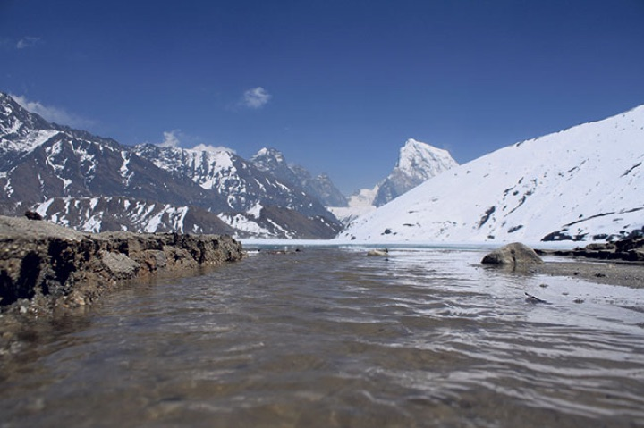Republica · 2025World Water Day 2025 on Glacier Preservation: What It Means for Nepal?</a>
<a class="tile tile-has-img" href="https://english.onlinekhabar.com/landslide-susceptibility-nepal.html">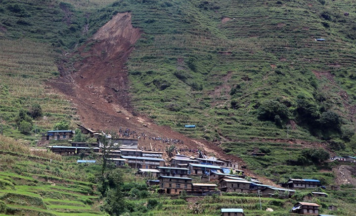Onlinekhabar · 2021Landslide susceptibility and monsoon preparedness in Nepal: An engineering perspective</a>
<a class="tile tile-has-img" href="https://www.onlinekhabar.com/2021/06/974746">Onlinekhabar · 2021मेलम्चीको बाढीबाट के सिक्ने ?</a>

## In the news

<h3 class="tile-year">2026</h3>

<a class="tile tile-has-img" href="https://higherlogicdownload.s3.amazonaws.com/AGU/31ea296c-2c70-4dad-92ef-c4681bc6a288/UploadedImages/Newsletters/AGU_Hydrology_Section_Newsletter_-_July_August_2026.pdf">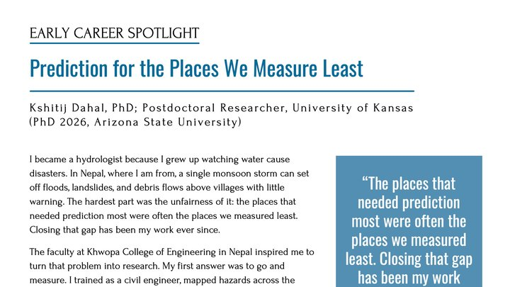AGU Hydrology Section NewsletterPrediction for the places we measure least (Early Career Spotlight)</a>
<a class="tile tile-has-img" href="https://www.sciencenews.org/article/flood-nepal-prepare-disaster-climate">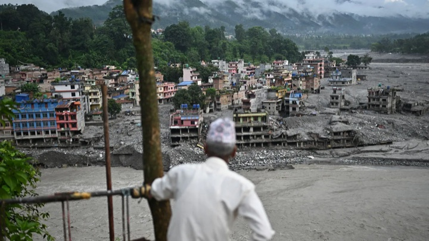Science NewsIn the wake of the flood, could Nepal avert the next disaster?</a>
<a class="tile tile-has-img" href="https://livingmountains.github.io/blog/2026/08/26/langtang-fox-weather.html">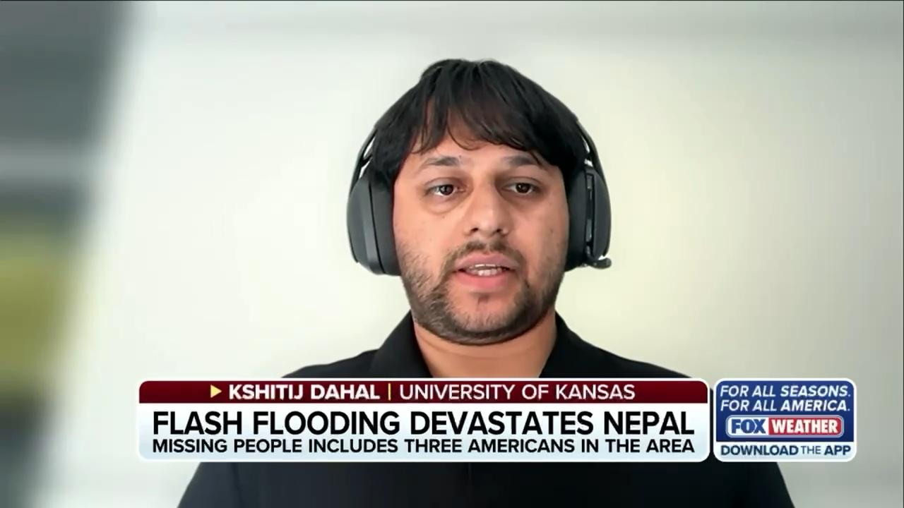FOX WeatherFlash flooding devastates Nepal (interview on the 2026 Langtang Disaster on the China–Nepal border)</a>
<a class="tile tile-has-img" href="https://timesofindia.indiatimes.com/city/patna/geoai-based-study-charts-flood-exposure-of-schools-in-state/amp_articleshow/128004523.cms">The Times of IndiaGeoAI-based study charts flood exposure of schools in state</a>

<h3 class="tile-year">2025</h3>

<a class="tile tile-has-img" href="https://www.chinadaily.com.cn/a/202503/27/WS67e4bd4da3101d4e4dc2b29b.html">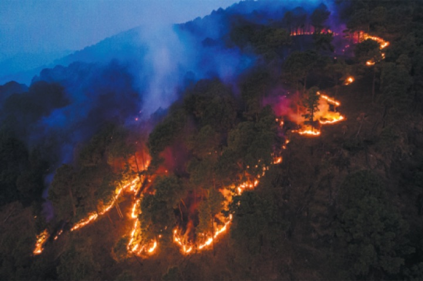China DailyTourism and biodiversity at risk as raging wildfires devastate forests in Nepal</a>
<a class="tile tile-has-img" href="https://risingnepaldaily.com/news/58977">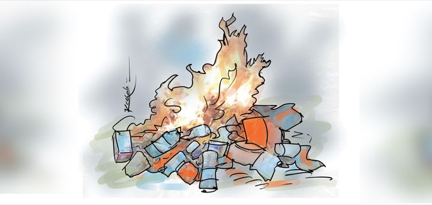The Rising NepalOpen burning main cause of air pollution</a>
<a class="tile tile-has-img" href="https://www.youtube.com/watch?v=UFb_3MyJpew">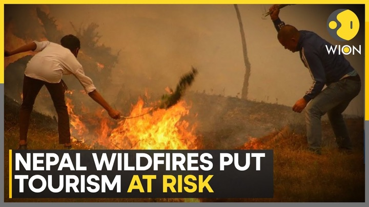WION TVWildfire Ravage Hundreds Of Acres Of Forest Land In Nepal - World News</a>
<a class="tile tile-has-img" href="https://kathmandupost.com/editorial/2025/03/18/ignored-infernos">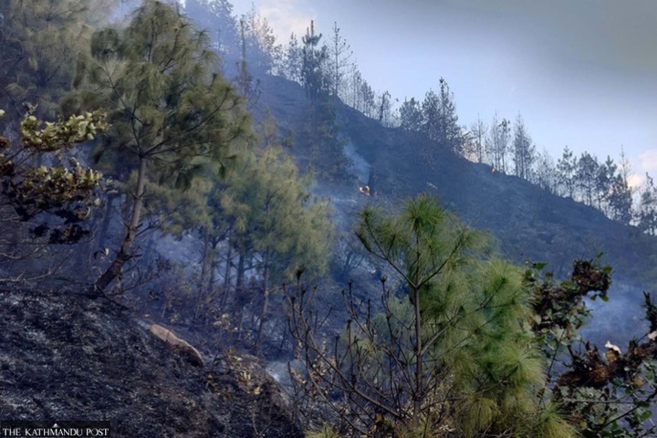The Kathmandu PostIgnored infernos</a>
<a class="tile tile-has-img" href="https://asianews.network/nepals-wildfires-put-500m-tonnes-of-carbon-and-tourism-at-risk">Asia News NetworkWildfires put 500m tonnes of carbon— and tourism—at risk</a>
<a class="tile tile-has-img" href="https://thehimalayantimes.com/nepal/wildfire-season-has-begun-but-the-worst-is-yet-to-come">The Himalayan TimesWildfire season has begun, but the worst is yet to come</a>
<a class="tile tile-has-img" href="https://kathmandupost.com/money/2025/03/17/wildfires-put-500m-tonnes-of-carbon-and-tourism-at-risk">The Kathmandu PostWildfires put 500m tonnes of carbon— and tourism—at risk</a>
<a class="tile tile-has-img" href="https://www.himalkhabar.com/news/144165">Himal KhabarLoss of Biodiversity Due to Wildfire (डढेलोबाट जैविक विविधता गुम्ने खतरा)</a>
<a class="tile tile-has-img" href="https://www.jalbayu.com/news/2025-03-15-2271">JalbayuStudy Report: Forests at Risk of Wildfire Due to Climate Crisis (अध्ययन रिपोर्ट : वन क्षेत्र जलवायु संकट कै कारण डढेलोको जोखिममा)</a>
<a class="tile tile-has-img" href="https://arthapranali.com/2025/03/11828">Artha PranaliForest Wildfires in Nepal Threaten 500 Million Tons of Carbon and Biodiversity (नेपालमा वन डढेलोले ५०० मिलियन टन कार्बन र जैविक विविधतामा खतरा)</a>
<a class="tile tile-has-img" href="https://www.everestpedia.com/detail/3646">EverestpediaForest Wildfires Pose a Threat to Carbon and Biodiversity (वन डढेलोले कार्बन र जैविक विविधतामा खतरा)</a>
<a class="tile tile-has-img" href="https://greeconomy.com/fire-impact-on-biodiversity">Green Economy‘Forest Wildfires Threaten Biodiversity’ (‘वन डढेलोले जैविक विविधतामा खतरा’)</a>
<a class="tile tile-has-img" href="https://kendrabindu.com/social-affairs/404665">KendraBinduForest Wildfires in Nepal Threaten 500 Million Tons of Carbon and Biodiversity (नेपालमा वन डढेलोले ५०० मिलियन टन कार्बन र जैविक विविधतामा खतरा)</a>
<a class="tile tile-has-img" href="https://jalasarokar.com/news/forest-fires-in-nepal-threaten-500-million-tons-of-carbon-and-biodiversity-2260">Jal SarokarForest Fires in Nepal Threaten 500 Million Tons of Carbon and Biodiversity (नेपालमा वन डढेलोले ५० करोड टन कार्बन र जैविक विविधतामा खतरा)</a>
<a class="tile tile-has-img" href="https://www.kavrekhabar.com/main-news/2025/03/16/3717">Kavre KhabarForest Wildfires in Nepal Threaten 500 Million Tons of Carbon and Biodiversity (नेपालमा वन डढेलोले ५ सय मिलियन टन कार्बन र जैविक विविधतामा खतरा)</a>
<a class="tile tile-has-img" href="https://www.eaarthik.com/2025/03/117227/">Arthik Digital NewsWildfires in Nepal pose threat to 500 million tons of carbon and biodiversity (नेपालमा वन डढेलोले ५०० मिलियन टन कार्बन र जैविक विविधतामा खतरा)</a>

<h3 class="tile-year">2024</h3>

<a class="tile tile-has-img" href="https://nepalitimes.com/here-now/back-to-the-land-in-the-cities">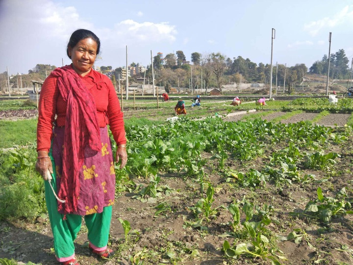Nepali TimesBack to the land in the cities</a>

<h3 class="tile-year">2022</h3>

<a class="tile tile-has-img" href="https://doi.org/10.1029/2022EO220113">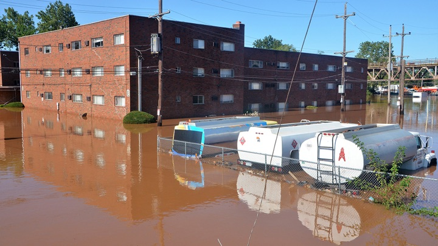EosICON Principles Underused as a Natural Hazards Research Tool</a>

<h3 class="tile-year">2021</h3>

<a class="tile tile-has-img" href="https://www.preventionweb.net/news/landslide-susceptibility-and-monsoon-preparedness-nepal-engineering-perspective">PreventionWeb, UNDRRLandslide susceptibility and monsoon preparedness in Nepal: An engineering perspective</a>

